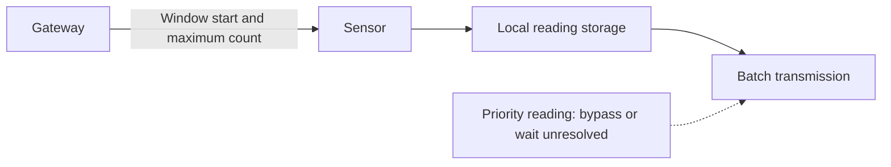
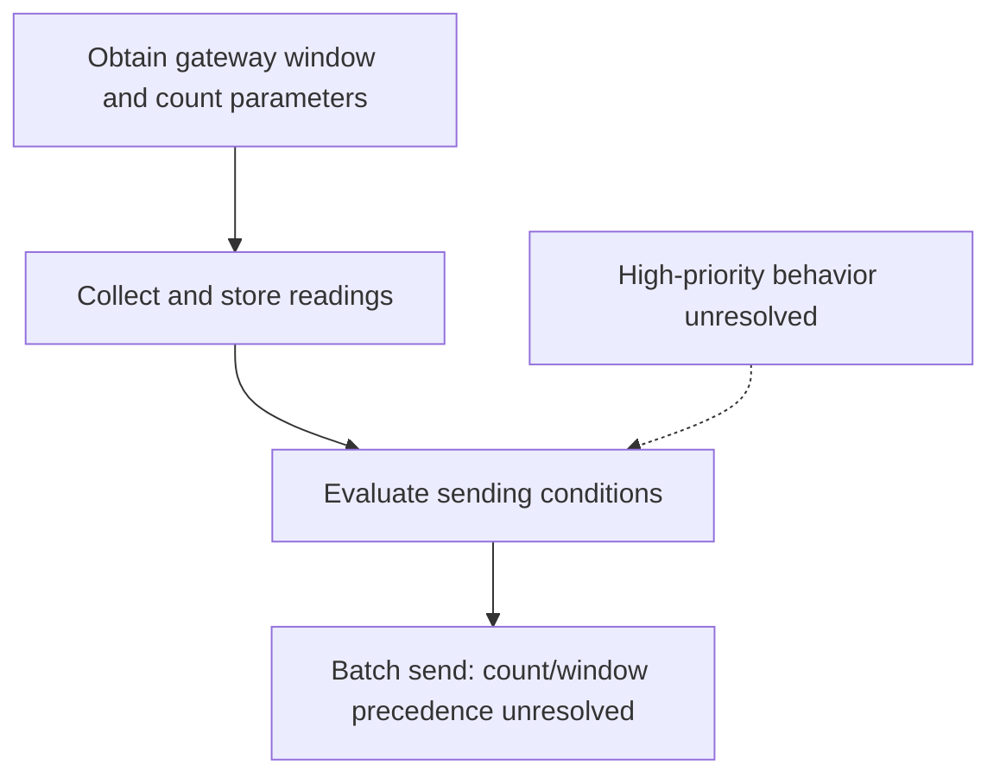

# Worked example: quiet-window batching

**Illustrative reference output, manually prepared for this repository. This is not a recorded model run or a legal opinion.**

## Disclosure

Working title: Gateway-directed batching of sensor readings.

Status: **Needs inventor clarification**, particularly the interaction of urgent readings, count triggers, and assigned windows.

### Source register

All four sources in `inputs.md` are readable in full. Paragraphs use the supplied § identifiers.

| ID | Source | Date |
| --- | --- | --- |
| SRC-01 | Inventor intake note | 2026-10-20 |
| SRC-02 | Design note | 2026-10-22 |
| SRC-03 | Follow-up transcript excerpt | 2026-10-23 |
| SRC-04 | Optional company context | 2026-10-24 |

### Plain-language explanation

**Source-supported:** The gateway tells each sensor when a sending window begins and how many readings a batch can contain. Sensors store readings and send them in groups. "Quiet" refers to fewer separate sends, not stopping measurement. The relationship between count-triggered sending and the assigned window remains unresolved. [SRC-01 §2] [SRC-03 §2]

### Problem and existing approach

**Source-supported inventor account:** Sensors ordinarily send one reading per minute; congestion leads to retries and additional energy use. This is a description of the inventor's existing system, not an independently established prior-art account. [SRC-01 §1]

### Mechanism and asserted contribution

**Source-supported:** A gateway supplies a window start time and maximum sample count. Sensor records contain a timestamp and priority flag. The asserted approach combines gateway direction with local buffering and batch transmission. Whether that combination is distinct from earlier techniques is unknown. [SRC-01 §2] [SRC-02 §1]

**Unresolved conflict:** The design note says a high-priority sample bypasses the buffer, while Mira describes a prototype in which every sample waits. Mira explicitly says production behavior has not been selected. Neither version can be treated as the final design. [SRC-02 §2] [SRC-03 §1]

**Unknown:** Clock synchronization, missed-message handling, and count/window precedence are not established. These gaps prevent a complete execution model. [SRC-02 §1] [SRC-03 §2]

### Architecture

Partial conceptual diagram, supported by [SRC-01 §2] and [SRC-02 §1]. The dotted priority relationship represents the conflict in [SRC-02 §2] and [SRC-03 §1]; it is not a confirmed path. The receiver of the outgoing readings is not specified in these sources.

### Process

Supported partial process from [SRC-01 §2], [SRC-02 §1], and [SRC-03 §2]. Handling for missed messages, clock behavior, and priority readings needs confirmation; the diagram deliberately does not resolve those branches. [SRC-02 §1] [SRC-03 §1]

### Advantages and alternatives

**Source-supported expectation, unmeasured:** Mira expects fewer wakeups and a 30% battery-life improvement. There is no battery test, so the percentage is not a demonstrated result. Preserving urgent alerts is an intended benefit, not an established outcome. [SRC-01 §2] [SRC-01 §3]

**Source-supported alternatives under discussion:** Immediate priority bypass and waiting until a window are described in competing materials; production selection is unresolved. Immediate attempts also do not guarantee prompt delivery under congestion. [SRC-02 §2] [SRC-03 §1]

**Proposed alternative, not inventor-attributed:** Ask whether a configurable maximum alert delay is technically useful. This idea is an interview prompt created for this example, not part of the disclosed mechanism or a contribution attributed to Mira or Theo.

### Reported contributors

Mira reports designing the sensor buffer policy and attributes gateway scheduling messages to Theo. Their specific conception histories need confirmation; these accounts do not establish legal inventorship. [SRC-01 §1]

## Prioritized follow-up questions

| Priority | Question | Why it matters | Source/gap | Respondent |
| --- | --- | --- | --- | --- |
| Critical | Which priority behavior exists in each prototype branch, and what production behavior is proposed? | Establishes the mechanism and whether alert responsiveness is supported. | SRC-02 §2; SRC-03 §1 | Mira and Theo |
| Critical | Walk through a sensor reaching its maximum count before the window begins. Does it send or wait? | Resolves the trigger precedence needed for a coherent process. | SRC-03 §2 | Mira and Theo |
| High | How are windows interpreted across clocks, and what happens after a missed scheduling message? | Establishes timing and failure behavior. | SRC-02 §1 | Gateway/sensor designers |
| High | What exactly will be shown or described publicly on November 18? Have there been earlier disclosures, offers, or sales? | Gives counsel the facts needed to assess timing; the supplied date is not itself a computed legal deadline. | SRC-01 §3; earlier activity unknown | Product lead and counsel |
| High | Which technical differences distinguish this from INT-017? Can counsel supply the actual claims and status? | Resolves a concrete candidate for portfolio overlap. | SRC-04 §2 | Counsel and inventors |
| Medium | What measurements and baseline support an energy benefit, and what alert-delay tradeoff is acceptable? | Separates expected benefits from demonstrated effects. | SRC-01 §3; SRC-02 §2 | Test owner/inventors |
| Medium | Who conceived each relevant feature, when, and through what exchanges? | Supports counsel's contribution review without assigning inventorship. | SRC-01 §1 | Reported contributors |

## Filing-review packet

### Readiness

**Analysis:** Further inventor clarification is needed before the disclosure can reliably describe the proposed production mechanism. The two critical questions above should be addressed first. This readiness assessment is not a file/no-file recommendation.

### Strategic fit

**Inference:** The disclosed batching approach appears relevant to Low-power edge telemetry and the Embedded Systems roadmap because reducing radio activity is its stated purpose. Whether it preserves alert responsiveness is unresolved. This is a mapping to supplied context, not a finding that it fills a documented portfolio gap. [SRC-01 §2] [SRC-04 §1]

### Portfolio

INT-017 is a candidate for overlap review based on its internal title alone. No claim-level comparison is possible from the supplied data. Its recorded pending status is not independently verified. There is insufficient evidence to count families, establish duplicative coverage, identify a company-wide gap, or assess freedom to operate. [SRC-04 §2]

### Criteria and legal questions

No filing scores or overall ranking are assigned because no company rubric is supplied. [SRC-04 §3]

Counsel should assess the actual technical contribution, supporting disclosure, relevant prior art, claim scope, jurisdiction-specific legal issues, and reported contributions after the factual gaps are addressed. The presence of timing logic or software does not itself resolve eligibility. No patentability or inventorship conclusion is made here.

### Cost and timing

Cost estimate and budget capacity are unavailable because unit costs and available budget are absent. [SRC-04 §3]

The planned public demo on November 18, 2026 needs prompt counsel review; its contents are not yet settled. The skill has not determined a legal filing deadline or whether deferral is safe. [SRC-01 §3]

### Next actions and decision record

- Mira and Theo: resolve priority behavior and count/window precedence.
- Product lead and counsel: review public-demo content and other disclosure history.
- Counsel: obtain INT-017 claims/status and decide what further analysis is required.
- Budget owner: supply costs and available budget if a financial review is requested.

Counsel decision: **pending**. No filing authorization has been given or inferred.
